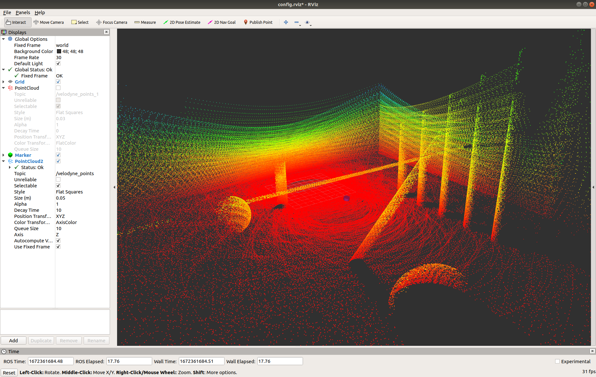

# lidar_sim

Simulation of a LiDAR based on geometric primitives. Below an example for the Velodyne VLP16 configuration.



## Standalone viewer (Ubuntu 22.04 and 24.04)

This is the primary setup. Ubuntu 22.04 and 24.04 have no ROS 1 packages. The viewer builds with plain CMake and needs Eigen, yaml-cpp and Qt 6:

```bash
git clone git@github.com:adrianomcr/lidar_sim.git
cd lidar_sim
sudo apt install build-essential cmake pkg-config libeigen3-dev libyaml-cpp-dev \
  qt6-base-dev libgl1-mesa-dev
./build.sh
./build/lidar_sim_viewer
```

Run the viewer from the `lidar_sim` directory. It opens `config/params.yaml` in the current directory when that file exists. `./build.sh` passes `-DLIDAR_SIM_WITH_ROS=OFF`, so this build stays independent of any ROS workspace.

`lidar_sim_viewer` reads `config/params.yaml` and `config/world.yaml`. The side panel edits the same parameters the ROS nodes use, and Save writes them back to the parameter file. Browse picks another world file. Play runs the circle (`sim_motion`) or the drone mission (`sim_drone`); the speed box is 1x by default. Decay, next to the point-size slider, is how long returns stay on screen in simulation seconds (0 keeps the latest scan). Points are colored by world-frame height. Left drag orbits the view, right drag pans, the wheel zooms.

```bash
./build/lidar_sim_viewer --world my_world.yaml --params my_params.yaml
./build/lidar_sim_viewer --check    # load, tessellate and compute one scan, then exit
```

## ROS (Ubuntu 20.04)

The ROS nodes need ROS Noetic, which is packaged for Ubuntu 20.04. Install it on a 20.04 machine, or run the Docker image below from a 22.04 or 24.04 host.

The native viewer and the Docker image can be used together on Ubuntu 24.04. `./build.sh` writes the viewer to `./build` on the host. The image is a separate Ubuntu 20.04 system: it copies this package and compiles it inside the image. Starting the container does not install ROS on the host and does not use `./build`. One clone of the repository is enough for both.

### Native Noetic

Requires ROS Noetic, Eigen 3 and yaml-cpp (`sudo apt install libeigen3-dev libyaml-cpp-dev python3-yaml`).

```bash
mkdir -p ~/simulation_ws/src
cd ~/simulation_ws/src
git clone git@github.com:adrianomcr/lidar_sim.git
cd ~/simulation_ws
catkin build --cmake-args -DCMAKE_BUILD_TYPE=Release
source devel/setup.bash
```

`./build.sh ros` is the same catkin build, run from a sourced workspace. With Qt 5 installed (`qtbase5-dev` and `libgl1-mesa-dev`), that build also produces the viewer.

### Docker

The image is based on `ros:noetic-ros-base-focal` (Ubuntu 20.04). During the image build it installs the ROS tools and these packages:

```bash
sudo apt install qtbase5-dev libgl1-mesa-dev libeigen3-dev libyaml-cpp-dev pkg-config
```

That install happens inside the image, not on the host. Qt 5 is what Ubuntu 20.04 provides, so the image builds `lidar_sim_viewer` together with the ROS nodes.

From the `lidar_sim` directory, build the image:

```bash
docker compose -f docker-compose.yaml build
```

Give Docker access to the X server, then open a shell in the container:

```bash
xhost +local:docker
docker compose -f docker-compose.yaml run --rm lidar_sim bash
```

Inside the container, `roslaunch lidar_sim example.launch` starts the simulation.

The Dockerfile copies the package and compiles it while the image is built. `docker-compose.yaml` does not mount the source tree, so a container keeps the files from the image. After changing code, configuration, or the Dockerfile, rebuild the image before starting the container again:

```bash
docker compose -f docker-compose.yaml build
docker compose -f docker-compose.yaml run --rm lidar_sim bash
```


## Use it

On the host, run `./build/lidar_sim_viewer`. With ROS, on 20.04 or inside the container:

```bash
roslaunch lidar_sim example.launch
```

Launch arguments:

| Argument | Default | Description |
| --- | --- | --- |
| `world` | `config/world.yaml` | Scene seen by the LiDAR |
| `params` | `config/params.yaml` | Parameters of all nodes |
| `motion` | `sim_drone` | Node that moves the LiDAR: `sim_drone` or `sim_motion` |
| `rviz` | `true` | Start RViz |

For example, `roslaunch lidar_sim example.launch motion:=sim_motion rviz:=false`.

### Nodes

- `sim_lidar` subscribes to `lidar_odom_gt` (`nav_msgs/Odometry`, the sensor pose) and publishes
  `velodyne_points` (`sensor_msgs/PointCloud2` with fields `x y z intensity ring azimuth distance`,
  a timestamp, and `return_number`) and the ground-truth TF `world -> tf_child_frame`
  (the same as `lidar` unless you set another child, such as `lidar_gt`, for a SLAM).
- `sim_motion` moves the LiDAR along a circle. It publishes `lidar_odom_gt`, `imu/data` and the
  `marker_lidar` marker.
- `sim_drone` flies a quadrotor carrying the LiDAR through a waypoint mission. Besides the topics
  of `sim_motion`, it publishes `drone_odom_gt` and the `marker_setpoint` marker.
- `investigate` prints a few points of `velodyne_points`, useful for debugging.


## Configuration

### Parameters: `config/params.yaml`
Every tunable value of the nodes lives in this file: the LiDAR model (rate, rings, field of view,
range, threads), the motion models (gains, gravity, start delays), the drone waypoints and the
markers. Each top-level key is the private namespace of a node, so it must match the node name.

### World: `config/world.yaml`
The scene is a list of objects, each one a geometric primitive:

```yaml
objects:
- type: cylinder                 # plane, sphere, cylinder, cone or ellipsoid
  description: Cylinder with plane constraint
  center: [-5, 12, 9]            # [m]
  angles: [1.57, 0, 0]           # roll, pitch, yaw [rad], optional
  radius: 0.5                    # sphere and cylinder
  plane_constraints:             # optional
  - normal: [0, 0, 1]
    point: [0, 0, -1]
- type: ellipsoid
  description: Airplane main fuselage
  center: [-30, 0, 5]
  size: [28, 4, 4]               # semi-axes along the local x, y and z axes [m]
```

Planes, cylinders and cones are infinite: the plane normal and the cylinder or cone axis are the
local z axis. A cone uses `slope` $k$, with local radius $k\lvert z \rvert$.
A plane constraint keeps only the part of the primitive where `normal . (p - point) > 0`, with `p`
expressed in the local frame of the primitive. This is how the finite cylinders and the open
ellipsoids of the example scene are built.

`config/world.yaml` is generated by `scripts/create_world.py`; edit the script and run it to
change the example hangar scene:
```bash
rosrun lidar_sim create_world.py            # writes config/world.yaml
rosrun lidar_sim create_world.py my_world.yaml
```


## Documentation

The [docs](docs/README.md) folder explains the code in depth: the
[architecture](docs/architecture.md), the [conventions](docs/conventions.md), the math of the
[ray casting](docs/ray_casting.md), [primitives](docs/primitives.md) and
[plane constraints](docs/constraints.md), the [LiDAR model](docs/lidar_model.md), the
[motion models](docs/motion_models.md), the full [parameter reference](docs/configuration.md)
and the [ROS interface](docs/ros_interface.md).

## About the software

The package is split in two libraries, plus a Qt viewer that does not need ROS:

- `lidar_sim_core` has no ROS dependency. It contains the primitives and constraints
  (`include/lidar_sim/geometry`), the `World` and its YAML loader, the `LidarScanner`, and the
  motion models (`include/lidar_sim/motion`): `MotionSimulator` (circular trajectory) and
  `DroneSimulator` (quadrotor controller and waypoint mission).
- `lidar_sim_ros` wraps the core in ROS nodes (`include/lidar_sim/ros`): parameter loading,
  message conversions and the node classes used by the executables in `src/nodes`.
- `lidar_sim_viewer` (`src/viewer`) is the Qt window described above. It links only the core.

The LiDAR can therefore be simulated without ROS:

```cpp
#include "lidar_sim/lidar_scanner.h"
#include "lidar_sim/world.h"

lidar_sim::World world = lidar_sim::loadWorldFile("config/world.yaml");

lidar_sim::LidarConfig config;
config.num_azimuth_steps = 1024;
config.num_rings = 64;
config.min_elevation = -45.0 * M_PI / 180.0;
config.max_elevation = 45.0 * M_PI / 180.0;
config.num_threads = 8;
lidar_sim::LidarScanner scanner(config);

std::vector<lidar_sim::LidarReturn> returns;
scanner.scan(world, Eigen::Vector3d(0, 0, 2), Eigen::Quaterniond::Identity(), returns);
for (const auto& r : returns) {
  if (r.valid) { /* r.point, r.distance, r.ring, ... */ }
}
```

### Available geometric primitives

- Plane
- Sphere
- Cylinder
- Ellipsoid

### Available constraints

- Plane

## Contact

Adriano Rezende

adrianomcr18@gmail.com
