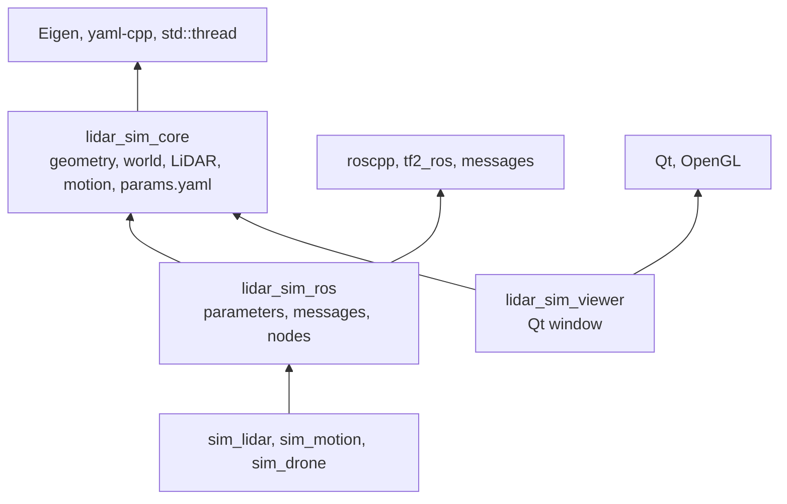
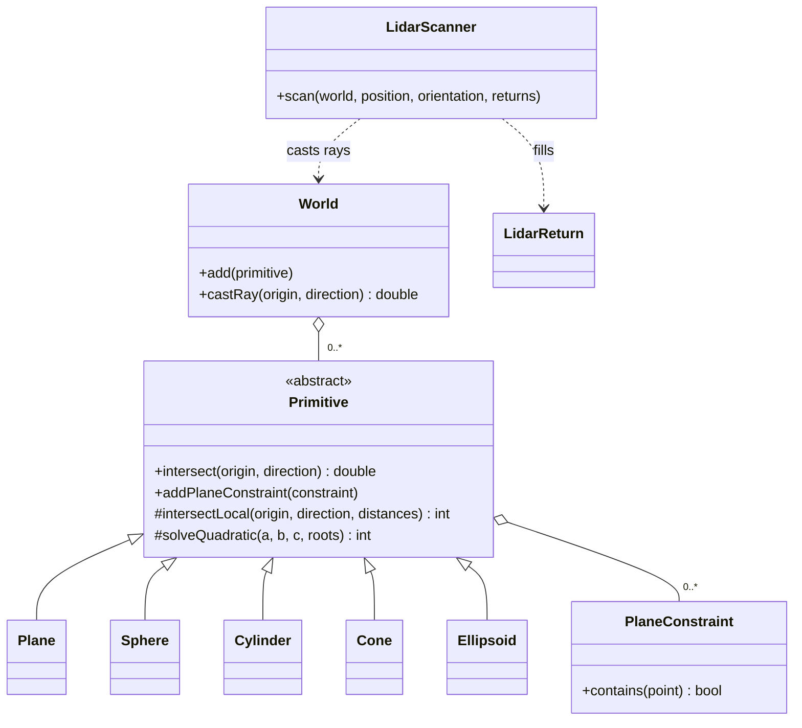
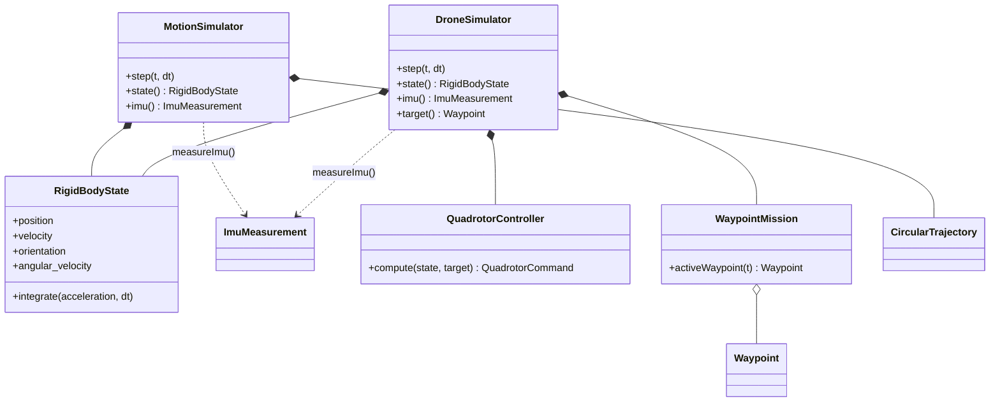
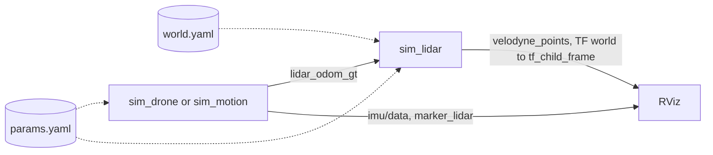

# Architecture

## Overview

The package is split in two libraries, the ROS nodes, and a desktop viewer that does not need ROS:

- **`lidar_sim_core`**: the simulation itself. It depends only on Eigen, yaml-cpp and the
  standard library, so it can be used from any C++ program, test or tool without ROS.
  `loadSimulationConfig()` reads `config/params.yaml` into that same library.
- **`lidar_sim_ros`**: ROS wrappers around the core. It reads parameters, converts core types to
  ROS messages and runs the publish loops. Built only when catkin is available.
- **Executables** (`src/nodes/`): `sim_lidar`, `sim_motion` and `sim_drone` only create a node
  object and call `run()`. `investigate` is a small standalone tool that prints cloud contents.
- **`lidar_sim_viewer`** (`src/viewer/`): a Qt window. It loads the same YAML files, steps the
  same simulators and draws the world and the point cloud with OpenGL. It needs Qt 5 or Qt 6,
  not ROS.



## Directory layout

```
lidar_sim/
├── config/
│   ├── params.yaml          parameters of every node
│   └── world.yaml           scene seen by the LiDAR (generated by scripts/create_world.py)
├── docs/                    this documentation
├── include/lidar_sim/
│   ├── geometry/            Primitive base class, Plane, Sphere, Cylinder, Cone, Ellipsoid, PlaneConstraint
│   ├── motion/              RigidBodyState, IMU model, trajectories, controllers, simulators
│   ├── ros/                 ROS nodes, parameter helpers, message conversions
│   ├── lidar_scanner.h      LiDAR model
│   ├── sim_config.h         loader and writer for params.yaml
│   ├── world.h              scene container and world file loader
│   └── math_utils.h         angle helpers
├── launch/example.launch    full simulation: LiDAR, motion model and RViz
├── rviz/config.rviz
├── scripts/create_world.py  world generator
└── src/
    ├── ...                  same layout as include/
    ├── nodes/               ROS executables
    └── viewer/              Qt viewer (scene mesh, OpenGL view, playback)
```

## Core library

### Geometry and scene



- **`Primitive`** owns the pose of a shape (center and orientation) and its plane constraints.
  `intersect()` moves the ray into the local frame, asks the subclass for the candidate
  intersections (`intersectLocal()`) and returns the first one in front of the ray that survives
  the constraints. Subclasses only solve the canonical shape in its own frame. See
  [Ray casting](ray_casting.md) and [Geometric primitives](primitives.md).
- **`PlaneConstraint`** is a half-space that keeps part of a primitive. See
  [Plane constraints](constraints.md).
- **`World`** is a list of primitives. `castRay()` returns the distance to the closest hit.
  `loadWorldFile()` builds a world from YAML (see [Configuration](configuration.md)).
- **`LidarScanner`** precomputes the beam directions from a `LidarConfig` and fills one
  `LidarReturn` per beam and firing. See [LiDAR model](lidar_model.md).

### Motion



Both simulators expose the same interface: `step(t, dt)` advances the state, then `state()` and
`imu()` read the result. The pieces are independent: `QuadrotorController` works with any
`RigidBodyState`, `CircularTrajectory` with any tracking law, and `measureImu()` with any body.
See [Motion models](motion_models.md).

## ROS layer

| Class | Wraps | Does |
| --- | --- | --- |
| `LidarSimNode` | `World`, `LidarScanner` | Loads the world, follows `lidar_odom_gt`, publishes the cloud and the TF |
| `MotionSimNode` | `MotionSimulator` | Steps the circle model at `update_rate` |
| `DroneSimNode` | `DroneSimulator` | Steps the drone model, publishes the drone odometry and the setpoint marker |
| `LidarStatePublisher` | | Publishes the LiDAR odometry, IMU and marker; shared by both motion nodes |

The helpers in `ros/params.h` read required parameters and fail with the full parameter name
when one is missing. `ros/conversions.h` turns core types into messages. Every node reads its
parameters from its private namespace (`~`), and topic names are relative, so they can be
remapped or pushed into a namespace from a launch file.

## Runtime data flow



1. The motion node integrates its model at 50 Hz and publishes the LiDAR pose on `lidar_odom_gt`.
2. `sim_lidar` keeps the latest pose. At 10 Hz it computes a full revolution with the sensor frozen
   at that pose, waits for the end of the scan period, and publishes the cloud and the
   `world -> tf_child_frame` transform with the same timestamp.

The nodes only share the `lidar_odom_gt` topic, so any other source of poses (a bag file, a
different simulator, a teleop node) can drive `sim_lidar`.

## Threading

`LidarScanner::scan()` splits the rings into `num_threads` contiguous blocks. Each thread writes
only the returns of its rings, and the world is read-only during a scan, so no locking is needed.
The calling thread processes the first block itself. Motion nodes are single threaded.

## Extending the code

### Adding a primitive

1. Derive from `Primitive` in `include/lidar_sim/geometry/` and implement `intersectLocal()`. It
   receives the ray in the primitive's local frame and must write the ray parameters of the
   intersections in ascending order (at most two) and return how many it wrote. Negative values
   are fine: `Primitive::intersect()` discards them and applies the constraints.
2. Add the source file to `lidar_sim_core` in `CMakeLists.txt`.
3. Parse the new `type` in `makePrimitive()` in `src/world.cpp`.
4. Add an `add_<type>()` method to `WorldBuilder` in `scripts/create_world.py`.
5. Draw it in `buildSceneMesh()` in `src/viewer/scene_mesh.cpp`, or the standalone viewer will
   load the world and then skip the new shape.
6. Document the math in [primitives.md](primitives.md).

For shapes that need more than two intersections (a torus has up to four), extend the
`distances` buffer in `Primitive`.

### Adding a motion model

1. Write a ROS-free simulator in `include/lidar_sim/motion/` with `step(t, dt)`, `state()` and
   `imu()`. Reuse `RigidBodyState::integrate()` and `measureImu()`.
2. Write a node in `include/lidar_sim/ros/` that reads its configuration with the helpers of
   `ros/params.h` and publishes through `LidarStatePublisher`, as `MotionSimNode` does.
3. Add a `main` in `src/nodes/`, register the executable in `CMakeLists.txt` and add a section
   named after the node to `config/params.yaml`.
4. Run it with `roslaunch lidar_sim example.launch motion:=<node name>`.

### Using the core without ROS

Link against `lidar_sim_core` and include the headers under `include/lidar_sim/`. With catkin the
library is exported by `catkin_package` and built in `devel/lib`. Without ROS, the plain CMake
build produces it next to `lidar_sim_viewer`. The main [README](../README.md) has a complete
example that loads a world and computes a scan, and the viewer is that example with a window.
