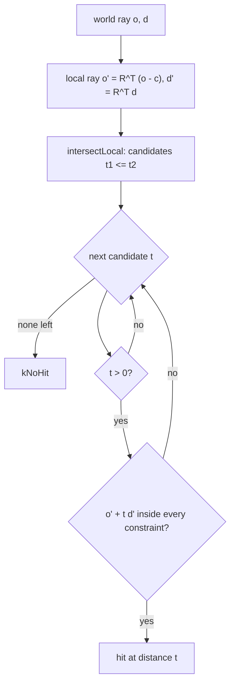

# Ray casting

Every LiDAR return comes from one ray cast against the world. This page explains the steps shared
by all primitives. The per-shape math is in [primitives.md](primitives.md) and the constraint
test in [constraints.md](constraints.md).

## The ray

A ray starts at the sensor position $o$ and travels along the unit direction $d$:

```math
r(t) = o + t\, d, \qquad \lVert d \rVert = 1, \quad t > 0.
```

Because $d$ has unit length, the ray parameter $t$ of a hit is its distance from the sensor.

## From the world to the primitive frame

Each primitive is defined in a local frame with origin $c$ (`center`) and rotation $R$ (`angles`),
where its shape has a simple equation: a plane is $z = 0$, a cylinder is $x^2 + y^2 = \rho^2$,
a cone is $x^2 + y^2 = k^2 z^2$, and so on. Instead of transforming the shape, `Primitive::intersect()` transforms the ray:

```math
o' = R^\top (o - c), \qquad d' = R^\top d.
```

$R^\top$ is a rotation, so $\lVert d' \rVert = 1$ and the local ray $o' + t\thinspace d'$ passes through
the local point $p' = R^\top(p - c)$ at the same $t$ as the world ray passes through $p$. **Ray
parameters computed in the local frame are therefore world distances**, and nothing has to be
transformed back. $R^\top$ is computed once per primitive when it is created.

## Candidate intersections

The subclass solves its shape in the local frame (`intersectLocal()`) and returns the ray
parameters where the ray meets the surface, in ascending order:

- Plane: at most one candidate.
- Sphere, cylinder, cone, ellipsoid: the real roots $t_1 \le t_2$ of a quadratic
  $a t^2 + b t + c = 0$, solved by `Primitive::solveQuadratic()`.

`solveQuadratic()` returns no roots when $|a| < 10^{-12}$ or when the discriminant
$b^2 - 4ac$ is negative (the ray misses). A tangent ray gives a double root. For a cylinder,
$a = 0$ means the ray is parallel to the axis and never meets it. For a cone, $a = 0$ means the
ray is parallel to a generatrix; `Cone::intersectLocal()` then solves the remaining linear
equation and can still return one hit.

## Selecting the visible hit

`Primitive::intersect()` walks the candidates in ascending order and returns the first one that

1. is in front of the sensor: $t > 0$, and
2. lies in the region kept by **every** plane constraint of the primitive, tested at the local
   point $p' = o' + t\thinspace d'$.

If no candidate qualifies, it returns `kNoHit` ($+\infty$).

Trying the second root matters. Primitives are infinitely thin **surfaces**, not solids, and are
visible from both sides:

- A sensor inside a sphere or an ellipsoid has $t_1 < 0 < t_2$ and sees the inner wall at $t_2$.
- When the near side of a shape is cut away by a constraint, the ray continues and can hit the
  inner side of the far wall. This is how you can look into the open airplane engines of the
  example scene.



## Closest hit in the world

`World::castRay()` intersects the ray with every primitive and keeps the smallest distance:

```math
t^\star = \min_k\, t_k(o, d).
```

The scene is the union of all surfaces, and the nearest one occludes the others. This alone can
build shapes without any constraint. The two roof planes of the example hangar,
$z = 25 + 0.3\thinspace y$ and $z = 25 - 0.3\thinspace y$, are infinite, but from inside the hangar the nearest one
is always the lower one, so the sensor sees a gabled roof $z = 25 - 0.3\thinspace |y|$.

The LiDAR then applies its range gate ($t_{\min} < t^\star < t_{\max}$, see
[LiDAR model](lidar_model.md)). A surface closer than `min_range` still occludes everything
behind it: the beam produces no return instead of reaching farther surfaces, as in a real sensor.

## Cost and precision

- A scan costs one ray-primitive test per beam, firing and object: with 1024 firings, 64 rings and
  57 objects, about 3.7 million tests per revolution. There is no acceleration structure (BVH,
  grid), which keeps the code simple for scenes of tens to a few hundreds of objects.
- All geometry runs in double precision. The quadratic discriminant of a thin, distant cylinder is
  the small difference of two large numbers, and single precision there produces millimeter
  errors at grazing angles. Values are only converted to `float` when the point cloud message is
  written.
