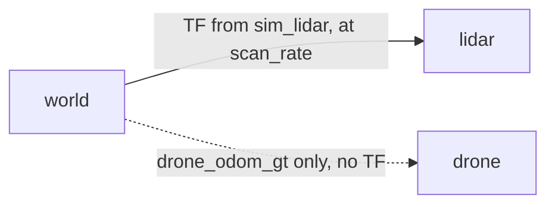

# ROS interface

All topic names are relative, so they resolve in the node's namespace (the global namespace with
`example.launch`) and can be remapped. Parameters are private (`~`); see
[Configuration](configuration.md#parameters). Stamps come from `ros::Time::now()`, so
`/use_sim_time` is honored.

## Nodes

### `sim_lidar`

Simulates the LiDAR against the world file.

| Direction | Topic | Type | Notes |
| --- | --- | --- | --- |
| Subscribes | `lidar_odom_gt` | `nav_msgs/Odometry` | Sensor pose in `world_frame`. Only the pose is used; the latest message wins. |
| Publishes | `velodyne_points` | `sensor_msgs/PointCloud2` | One cloud per revolution at `scan_rate`, in `lidar_frame` ([format](lidar_model.md#point-cloud-format)) |
| Publishes | `/tf` | `world_frame -> lidar_frame` | Same stamp and pose as the cloud |

Until the first odometry message arrives the sensor stays at `initial_position` /
`initial_rpy_deg`.

### `sim_motion`

Moves the LiDAR along a circle ([Motion models](motion_models.md#circle-motionsimulator)).

| Direction | Topic | Type | Notes |
| --- | --- | --- | --- |
| Publishes | `lidar_odom_gt` | `nav_msgs/Odometry` | LiDAR pose, `world_frame` to `lidar_frame` |
| Publishes | `imu/data` | `sensor_msgs/Imu` | Orientation, angular velocity and specific force in `lidar_frame` |
| Publishes | `marker_lidar` | `visualization_msgs/Marker` | Cylinder at the LiDAR pose |

All at `update_rate`.

### `sim_drone`

Flies a quadrotor carrying the LiDAR ([Motion models](motion_models.md#quadrotor-dronesimulator)).
Publishes the three topics of `sim_motion`, plus:

| Direction | Topic | Type | Notes |
| --- | --- | --- | --- |
| Publishes | `drone_odom_gt` | `nav_msgs/Odometry` | Drone body pose, `world_frame` to `drone_frame` |
| Publishes | `marker_setpoint` | `visualization_msgs/Marker` | Sphere at the active waypoint |

### `investigate`

Debugging tool. Subscribes to `velodyne_points` and prints `num_samples` evenly spread points of
every cloud with all their fields.

## Message contents

- **Odometry**: only the pose is filled. The twist and all covariances are zero.
- **IMU**: ideal measurements ([IMU model](motion_models.md#imu-model)). Covariances are zero.
- **Markers**: namespace `lidar_marker` or `setpoint_marker`, id 0, in `world_frame`. Size and
  color come from the parameters.

## Frames and TF



- The `world -> lidar` transform is broadcast by `sim_lidar`, not by the motion node, at the scan
  rate and with the exact pose used for the scan. RViz can therefore always place the cloud.
- No TF is published for the `drone` frame. Publish one from `drone_odom_gt` if you need it.

## Driving the LiDAR from another source

`sim_lidar` only needs poses on `lidar_odom_gt`, so the motion nodes can be replaced by anything
that publishes `nav_msgs/Odometry`: a bag file, another simulator, or a single message for a
static sensor:

```bash
rostopic pub -1 /lidar_odom_gt nav_msgs/Odometry \
  "{header: {frame_id: world}, pose: {pose: {position: {x: -12, y: 3, z: 6}, orientation: {w: 1}}}}"
```

To publish the cloud somewhere else, remap it in a launch file:

```xml
<node pkg="lidar_sim" type="sim_lidar" name="sim_lidar">
  <remap from="velodyne_points" to="/sensors/lidar/points"/>
  <param name="world_file" value="$(find lidar_sim)/config/world.yaml"/>
</node>
```
